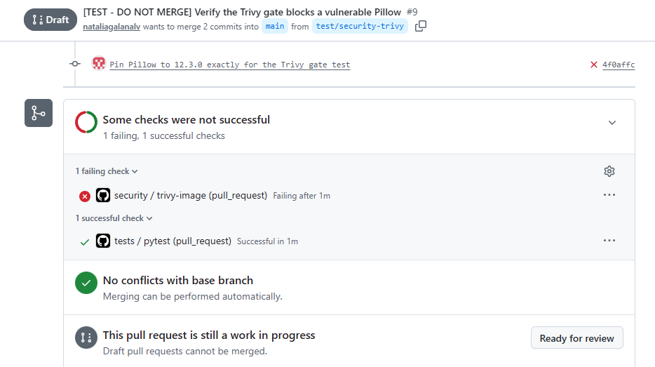
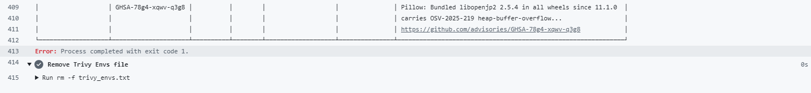
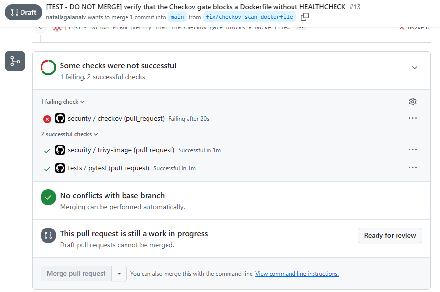
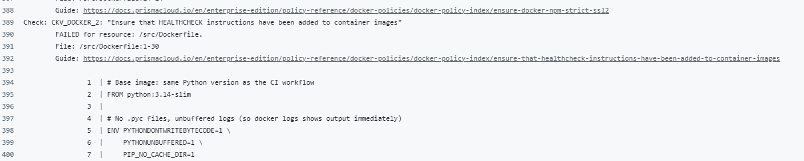

# Flower Classifier (Oxford 102 Flowers)


Image classifier for the [Oxford 102 Flowers](https://www.robots.ox.ac.uk/~vgg/data/flowers/102/) dataset, built with PyTorch. Compares a convolutional neural network trained from scratch against transfer learning with ResNet18 (feature extraction and fine-tuning).

**Best result: 87.87% accuracy on the held-out test set**, using a fine-tuned ResNet18 (last residual block unfrozen). See [`docs/results.md`](./docs/results.md) for the full experiment log and [`docs/analysis_results.md`](./docs/analysis_results.md) for the write-up of findings and conclusions.

## Quick start: classify an image

1. Install the project (see [Setup](#setup)).
2. Download `best_resnet18_finetune.pth` from the [latest release](https://github.com/nataliagalanalv/flower-classifier/releases/latest) and place it in the `outputs/` folder. The SHA256 of the file is listed in the release notes, so you can verify the download.
3. Run the predictor on any image:
```powershell
   python -m flower_classifier.predict photo.jpg
```

Example output (top-5 predictions, with the model's confidence):

```
pink primrose             86.8%
petunia                   5.2%
bougainvillea             0.9%
pelargonium               0.7%
camellia                  0.5%
```

Use `--top-k N` to change how many classes are shown and `--checkpoint PATH` to use a different checkpoint.

> The percentages are the model's softmax confidence, not a calibrated probability of being right: neural networks tend to be more confident than their accuracy justifies, and an image that is not a flower will still get a prediction.

## Project structure

```
flower-classifier/
├── .github/
│   └── workflows/
│       ├── tests.yml              # CI: runs pytest on every push to main and on pull requests
│       └── security.yml           # CI: Trivy image scan and Checkov configuration scan (both blocking)
├── .dockerignore                  # keeps the Docker build context small (excludes data/, outputs/, venv, tests, docs)
├── Dockerfile                     # image of the web app: python:3.14-slim, CPU-only PyTorch, non-root user, HEALTHCHECK
├── pyproject.toml                 # package metadata and dependencies (src-layout, setuptools)
├── src/
│   └── flower_classifier/
│       ├── __init__.py
│       ├── explore_data.py        # quick, raw dataset exploration
│       ├── data_setup.py          # dataloaders for all models: train/val (+ test on request), size set via img_size
│       ├── transforms.py          # train (augmentation) and eval transforms, ImageNet normalization
│       ├── model.py               # SimpleCNN architecture (from scratch)
│       ├── model_transfer.py      # ResNet18 builders (feature extraction / fine-tuning) + checkpoint loader
│       ├── class_names.py         # class index -> flower name mapping
│       ├── engine.py              # shared train_one_epoch() and evaluate() loops
│       ├── train.py               # unified training CLI: --model cnn | resnet18-fe | resnet18-ft
│       ├── evaluate.py            # final, one-time evaluation on the test split
│       ├── confusion_analysis.py  # confusion matrix, per-class accuracy, hardest classes
│       ├── predict.py             # classify one image and print the top-5 flower names
│       └── resources/
│           ├── cat_to_name.json          # class index -> flower name (see "Notes on data sources")
│           └── LICENSE-cat_to_name.txt   # license notice for that file
├── app/                            # FastAPI web app: upload an image, get the top predictions
│   ├── main.py                     # API: GET /, GET /health, POST /predict (model loaded once at startup)
│   ├── static/
│   │   ├── app.js                  # page logic: JavaScript with JSDoc types, no build step
│   │   └── style.css
│   └── templates/
│       └── index.html              # the web page
├── docs/
│   ├── images/                     # screenshots used as evidence in this README
│   ├── analysis_results.md
│   ├── results.md
│   ├── security.md                 
│   └── testing.md
├── tests/                          # pytest suite
│   ├── test_api.py                 # FastAPI endpoints with a fake model (valid/invalid input, startup failures)
│   ├── test_class_names.py         # idx_to_name mapping logic
│   ├── test_engine.py              # train_one_epoch / evaluate on toy data (weight updates, modes, exact metrics)
│   ├── test_gpu.py                 # engine on CUDA (skipped when no GPU is available)
│   ├── test_model.py               # SimpleCNN output shape
│   ├── test_model_transfer.py      # ResNet18 layer freezing + output shape
│   ├── test_predict.py             # predict_top_k with a fake model (ordering, probabilities, non-RGB images)
│   ├── test_train.py               # model registry, CLI parsing and main() wiring
│   └── test_transforms.py          # output shapes, determinism, normalization
├── data/                           # dataset (downloaded automatically, gitignored)
└── outputs/                        # checkpoints (.pth, gitignored; published as a GitHub Release) and confusion_matrix.png
```

## Setup

Tested with Python 3.14 on Windows 11 with an NVIDIA GPU (CUDA 12.6). The CI runs on Ubuntu with CPU-only PyTorch, also on Python 3.14.

1. Create and activate a virtual environment:
```powershell
   python -m venv venv
   venv\Scripts\Activate.ps1
```

2. Install PyTorch with CUDA support **first**, using the official selector at [pytorch.org/get-started/locally](https://pytorch.org/get-started/locally/) — the exact command depends on your GPU driver's supported CUDA version. Example:
```powershell
   pip3 install torch torchvision --index-url https://download.pytorch.org/whl/cu126
```
   > `pyproject.toml` declares `torch` and `torchvision` as dependencies but cannot choose between the CPU and CUDA builds. If they are not installed beforehand, pip will install its default build, which may be CPU-only. Verify your install with:
   > ```python
   > import torch
   > print(torch.__version__, torch.cuda.is_available())
   > ```

3. Install the project and its dependencies as an editable package (needed for the internal imports to resolve and for running modules with `python -m`). The `dev` extra adds `pytest` and the HTTP client used to test the API; the `api` extra adds FastAPI and the `uvicorn` server for the [web app](#web-app):
```powershell
   pip install -e ".[dev,api]"
```

## Training and evaluation

Run these from the project root. The dataset downloads automatically on first run into `data/`.

```powershell
# 1. (Optional) Explore the raw dataset
python -m flower_classifier.explore_data

# 2. Train a model. Choose one with --model:
python -m flower_classifier.train --model cnn           # CNN from scratch
python -m flower_classifier.train --model resnet18-fe   # ResNet18, backbone frozen (feature extraction)
python -m flower_classifier.train --model resnet18-ft   # ResNet18, layer4 unfrozen (fine-tuning)

# 3. Evaluate the fine-tuned model on the held-out test split
python -m flower_classifier.evaluate

# 4. Error analysis: confusion matrix, per-class accuracy, hardest classes
python -m flower_classifier.confusion_analysis
```

Each model has its own defaults (epochs, learning rate, weight decay), which can be overridden with `--epochs`, `--lr`, `--weight-decay` and `--output-dir`. Run `python -m flower_classifier.train --help` for the details.

`evaluate` and `confusion_analysis` read `outputs/best_resnet18_finetune.pth` by default (`--checkpoint` to change it): either train it with `--model resnet18-ft` or download it from the release.

> No random seed is fixed in this project, so retraining gives slightly different numbers from those in `docs/results.md`.

## Web app

A small FastAPI server wraps the same model: open a page, upload a photo and see the top predictions. It needs the `api` extra (see [Setup](#setup)) and the checkpoint `outputs/best_resnet18_finetune.pth` (see [Quick start](#quick-start-classify-an-image)).

```powershell
uvicorn app.main:app
```

Run it from the project root and open <http://127.0.0.1:8000>. The interactive API documentation that FastAPI generates is at <http://127.0.0.1:8000/docs>. Add `--reload` while developing.

| Endpoint | What it does |
| --- | --- |
| `GET /` | The web page: upload an image and see the ranked predictions. |
| `GET /health` | `{"status": "ok", "model_loaded": true}`. Meant for health checks. |
| `POST /predict?top_k=5` | Takes an image as multipart form data (field `file`) and returns the top-k predictions as JSON. `top_k` goes from 1 to 102 (default 5). |

Example, from the command line (probabilities rounded here):

```powershell
curl.exe -F "file=@photo.jpg" "http://127.0.0.1:8000/predict?top_k=3"
```

```json
{"predictions": [{"name": "barbeton daisy", "probability": 0.8558}, {"name": "carnation", "probability": 0.0334}, {"name": "tree mallow", "probability": 0.0151}]}
```

Errors: `400` if the file is not a valid image, `422` if `top_k` is out of range or the file is missing, `503` if the model is not loaded.

The model is loaded once, when the server starts. If the checkpoint is missing or cannot be loaded, the server refuses to start and the message says which file it looked for. To use a checkpoint stored elsewhere, set the `CHECKPOINT_PATH` environment variable (in PowerShell: `$env:CHECKPOINT_PATH = "path\to\file.pth"`).

## Docker

The web app can also run in a container, so it works the same on any machine with Docker. It needs the checkpoint `outputs/best_resnet18_finetune.pth` (see [Quick start](#quick-start-classify-an-image)), which is deliberately **not** baked into the image.

```powershell
docker build -t flower-classifier .
docker run --rm -p 8000:8000 -v "${PWD}\outputs:/models" -e CHECKPOINT_PATH=/models/best_resnet18_finetune.pth flower-classifier
```

On Linux or macOS, replace the volume with `-v "$(pwd)/outputs:/models"`. Then open <http://localhost:8000>; the endpoints are the ones described in [Web app](#web-app).

| Flag | Purpose |
| --- | --- |
| `--rm` | Remove the container when it stops. |
| `-p 8000:8000` | Publish the container port on your machine. |
| `-v ...:/models` | Mount your local `outputs/` folder inside the container. |
| `-e CHECKPOINT_PATH=...` | Tell the app where the model file is. |

Without the checkpoint, the container exits at startup with a `Checkpoint not found` error, same as running the server locally.

Design decisions:

- **Base image:** `python:3.14-slim`, the same Python version as the CI.
- **CPU-only PyTorch:** installed from the PyTorch CPU index to keep the image smaller (about 445 MB compressed, about 2 GB on disk).
- **Model outside the image:** it is provided at runtime, so a new model does not require rebuilding the image.
- **Non-root user:** the app does not run as root inside the container.
- **Health check:** a `HEALTHCHECK` calls `/health` with Python (the slim image has no `curl`). `--start-period=30s` leaves time to load PyTorch and the model; `docker ps` shows `(healthy)` once the app answers.
- **`.dockerignore`:** keeps the build context at about 66 KB instead of 660+ MB (dataset, checkpoints, virtual environment, tests and docs are excluded).

### Vulnerability scanning

The image is scanned with [Trivy](https://trivy.dev/) v0.76.1, run from its official container image. The image is exported to a file first, so the scanner does not need access to the Docker socket. Build without cache so an old cached layer does not keep outdated dependency versions:

```powershell
docker build --no-cache -t flower-classifier .
docker save flower-classifier:latest -o $env:TEMP\scan\flower-classifier.tar
docker run --rm -v "$env:TEMP\scan:/scan:ro" -v trivy-cache:/root/.cache/ ghcr.io/aquasecurity/trivy:0.76.1 image --input /scan/flower-classifier.tar --scanners vuln --severity HIGH,CRITICAL --timeout 30m
```

Results (HIGH and CRITICAL only; date of the last scan: 2026-10-29):

| | Initial | After Pillow 13 | After removing `pip` and `setuptools` |
| --- | --- | --- | --- |
| Python packages | 37 (5 critical) | 9 (0 critical) | 0 |
| Pillow | 28 | 0 | 0 |
| Debian base image | 44 (no fix available) | 44 (no fix available) | 44 (no fix available) |

Two changes removed the Python findings. Upgrading Pillow to 13.0.0 fixed 28 of them (Pillow decodes the images users upload). The remaining 9 were in packaging tools that the running app does not need, so the `Dockerfile` uninstalls `pip` and `setuptools` after installing the project. The trade-off is that nothing can be installed inside a running container, which is the normal practice for immutable images. The image must also be built without a stale cache (`--no-cache`), as CI does by building from scratch.

The 44 Debian findings are in the base image and have no patched package yet. A scan reports known vulnerabilities in packages; it does not by itself prove security or regulatory compliance.

The scan is blocking in CI (`security.yml`, job `trivy-image`): it builds the image from scratch, scans it with `--severity HIGH,CRITICAL --ignore-unfixed` and fails with exit code 1 if it finds anything. `--ignore-unfixed` hides findings that have no patched version yet, since nothing can be done about them in this repository. That is why the Debian findings above do not block the pipeline: they are an accepted risk, to be reviewed when the base image changes. The local command above does not use `--ignore-unfixed`, so it shows everything. The Trivy version is fixed (v0.76.1) and the GitHub Actions are pinned by commit SHA.

To verify the gate, [PR #9](https://github.com/nataliagalanalv/flower-classifier/pull/9) (closed, never merged) pinned the vulnerable Pillow 12.3.0 on purpose: the `security` check failed with exit code 1 and the Pillow findings, while `tests` passed.





### Configuration scanning

[Checkov](https://www.checkov.io/) 3.4.0 checks the `Dockerfile` and the GitHub Actions workflows against its built-in rules (for example: a `HEALTHCHECK` exists, the container does not run as root, the base image is not `latest`, the workflow token has restricted permissions). Trivy looks at what is inside the image; Checkov looks at how the image and the pipeline are configured. It runs from its official container image, pinned by digest, in two separate steps (one per target):

```powershell
docker run --rm --volume "${PWD}:/src:ro" --workdir /src bridgecrew/checkov@sha256:ece5efac4443084ca273072909985dce988a81e8cc94faa305aeda0df27c68f9 --file /src/Dockerfile
docker run --rm --volume "${PWD}:/src:ro" --workdir /src bridgecrew/checkov@sha256:ece5efac4443084ca273072909985dce988a81e8cc94faa305aeda0df27c68f9 --directory /src/.github/workflows
```

The first run reported two findings, both fixed:

| Check | Where | Fix |
| --- | --- | --- |
| `CKV_DOCKER_2` (no `HEALTHCHECK`) | `Dockerfile` | Added a `HEALTHCHECK` on `/health`. |
| `CKV2_GHA_1` (no top-level permissions) | `tests.yml` | Added `permissions: contents: read`. |

Current result: `Dockerfile` 82 passed, 0 failed; workflows 68 passed, 0 failed; no checks skipped. The job is blocking in CI.

The gate was verified with a negative test: [PR #13](https://github.com/nataliagalanalv/flower-classifier/pull/13) (closed, never merged) removed the `HEALTHCHECK` and the `checkov` job failed with `CKV_DOCKER_2`, while `tests` and `trivy-image` passed.





A first version of the job passed both targets in a single command and silently scanned only the workflows: the CI log had no `dockerfile scan results` block, so removing the `HEALTHCHECK` did not fail the check. It was found because the negative test stayed green, and fixed in [PR #14](https://github.com/nataliagalanalv/flower-classifier/pull/14) by splitting the scan into one step per target. A green check does not show what was scanned, so the job log is part of the review.

A clean result means the rules Checkov knows passed; it does not prove the pipeline is secure or compliant. For example, pinning actions by commit SHA is done by hand here, and no rule about it appeared in the output.

Accepted risks, known gaps and next steps are documented in [`docs/security.md`](./docs/security.md).

## Approach summary

| Approach | Trainable params | Val Accuracy | Test Accuracy |
| --- | --- | --- | --- |
| CNN from scratch | ~11.2M (100%) | 37.65% | — |
| ResNet18 feature extraction | 52,326 (0.47%) | 79.22% | — |
| **ResNet18 fine-tuning** (`layer4` + `fc`) | 8,446,054 (~75%) | 90.78% | **87.87%** |

Full breakdown, per-class accuracy, and the most frequent misclassifications are in [`docs/results.md`](./docs/results.md). Interpretation of why transfer learning wins here, the effect (or lack thereof) of weight_decay, and dataset-imbalance caveats are in [`docs/analysis_results.md`](./docs/analysis_results.md).

## Testing

The project includes a pytest suite (65 tests) covering model architecture shapes, layer freezing in transfer learning, the class-index-to-name mapping, the training/evaluation loops (`engine.py`), the image transforms, top-k prediction, the model registry and CLI of `train.py`, and the FastAPI endpoints (valid and invalid requests, startup failures). It does not run real training (slow, non-deterministic, needs the dataset); instead, the loops are tested on tiny synthetic data and fake models, and the API tests use a fake model, so they need no checkpoint. See [`docs/testing.md`](./docs/testing.md) for the full rationale, a breakdown of each test and what is not covered.

Run the suite from the project root:

```powershell
pytest -v
```

The same suite runs automatically on GitHub Actions for every push to `main` and every pull request, in a clean environment with CPU-only PyTorch. The `security` workflow (Trivy and Checkov, see [Docker](#docker)) runs on the same events.

## Notes on data sources

- Class names (flower species) come from a community-maintained `cat_to_name.json` mapping, not an official torchvision/Oxford source — treat names as approximate; the numeric class index (0–101) is the reliable reference. See [`docs/analysis_results.md`](./docs/analysis_results.md) for a known inconsistency found in this file.
- The `cat_to_name.json` file originates from Udacity's [`aipnd-project`](https://github.com/udacity/aipnd-project) repository, released under the MIT license. The license notice is kept in [`src/flower_classifier/resources/LICENSE-cat_to_name.txt`](./src/flower_classifier/resources/LICENSE-cat_to_name.txt).