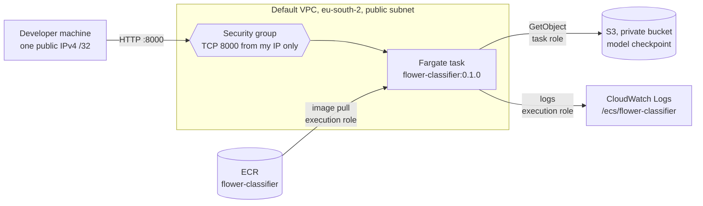
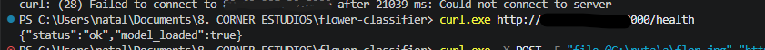
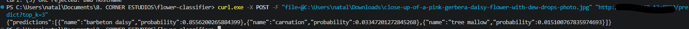
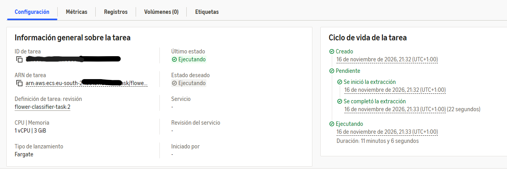
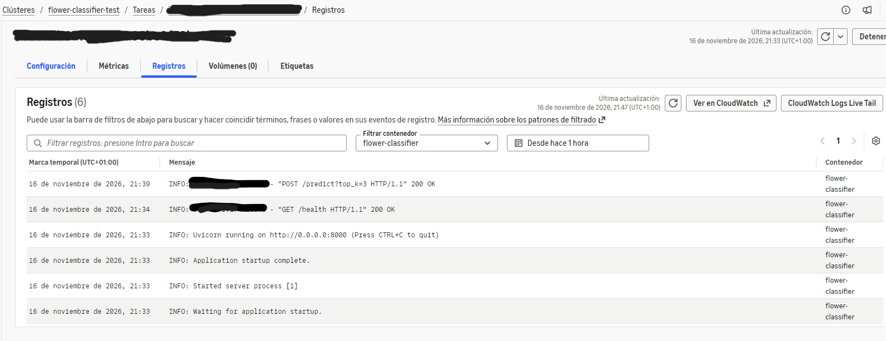
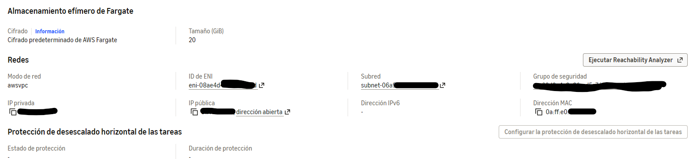

# Manual deployment on AWS (proof of concept)

A one-off run of the web app on **Amazon ECS with Fargate**, built by hand in the AWS console on 2026-11-16. The goal was to understand each piece before writing it as Terraform, not to build something production-ready. What was kept and what was destroyed is listed in [Resources](#resources).

Account IDs, public IP addresses and the model hash are left out of this document and of the screenshots on purpose.

## Goal and scope

**Goal:** show that the container from [`Dockerfile`](../Dockerfile) runs end to end on AWS:

- the image is pulled from a private registry (ECR);
- the model is downloaded at startup from a private S3 bucket, using an IAM role instead of access keys;
- the model file is verified against a SHA-256 hash before it is loaded;
- the API answers `/health` and `/predict` over HTTP from one allowed IP address and from nowhere else.

**Not in scope:** TLS, a load balancer, autoscaling, authentication, automation. They are listed in [Limitations](#limitations-and-accepted-trade-offs) and [Next steps](#next-steps).

**Why by hand:** doing it in the console first makes every setting visible, and several of the problems in [Problems found and lessons](#problems-found-and-lessons) would have been harder to understand inside Terraform.

## Architecture



The model is not inside the image. The container downloads it when it starts, so a new model does not need a new image.

### Two IAM roles, two jobs

ECS needs two different roles, and mixing them up is a common mistake:

| Role | Used by | Permissions | Why it is separate |
| --- | --- | --- | --- |
| `ecsTaskExecutionRole` | The ECS/Fargate agent, around the container: pulling the image, sending logs | AWS managed policy `AmazonECSTaskExecutionRolePolicy` | Infrastructure plumbing. The application never uses it. |
| `flower-classifier-task-role` | The application code inside the container (`boto3`) | Custom policy `flower-classifier-read-model` (below) | Least privilege: the app can read the model file and nothing else. |

Both roles trust `ecs-tasks.amazonaws.com`.

Custom policy attached to the task role. It allows one action on one object:

```json
{
  "Version": "2012-10-17",
  "Statement": [
    {
      "Sid": "ReadModelCheckpoint",
      "Effect": "Allow",
      "Action": "s3:GetObject",
      "Resource": "arn:aws:s3:::flower-classifier-model-resnet18/models/best_resnet18_finetune.pth"
    }
  ]
}
```

Trust policy of the task role. The two conditions limit who can use the role to ECS in this account and region, which protects against the [confused deputy problem](https://docs.aws.amazon.com/IAM/latest/UserGuide/confused-deputy.html):

```json
{
  "Version": "2012-10-17",
  "Statement": [
    {
      "Effect": "Allow",
      "Principal": { "Service": "ecs-tasks.amazonaws.com" },
      "Action": "sts:AssumeRole",
      "Condition": {
        "StringEquals": { "aws:SourceAccount": "<ACCOUNT_ID>" },
        "ArnLike": { "aws:SourceArn": "arn:aws:ecs:eu-south-2:<ACCOUNT_ID>:*" }
      }
    }
  ]
}
```

## Resources

Everything was created in region `eu-south-2` (Spain).

| Resource | Name and key settings | Purpose | After the test |
| --- | --- | --- | --- |
| S3 bucket | `flower-classifier-model-resnet18`. Block all public access, SSE-S3 encryption, versioning on. Object `models/best_resnet18_finetune.pth`, 44,996,555 bytes | Stores the model checkpoint | Kept |
| ECR repository | `flower-classifier`. Private, immutable tags, AES-256. Image tag `0.1.0` (about 0.47 GB) | Stores the container image | Kept |
| IAM policy and roles | `flower-classifier-read-model`, `flower-classifier-task-role`, `ecsTaskExecutionRole` | See [above](#two-iam-roles-two-jobs) | Kept |
| CloudWatch log group | `/ecs/flower-classifier`. Standard class, 1 week retention, no customer-managed KMS key | Container logs | Destroyed |
| Security group | `flower-classifier-sg`. Inbound: TCP 8000 from one IPv4 address (`/32`). Outbound: default (all) | The only way in | Destroyed |
| ECS cluster | `flower-classifier-test`, Fargate only | Where tasks run | Destroyed |
| Task definition | `flower-classifier-task`, revision 2: 1 vCPU, 3 GiB, Linux/X86_64, network mode `awsvpc`, port 8000, `awslogs` driver | The recipe for the container | Registered revisions are only configuration; nothing runs from them |
| Fargate tasks | Standalone tasks (not a service), public IP, one public subnet of the default VPC | Ran the app | Stopped |
| Network | Default VPC (`172.31.0.0/16`), public subnet, auto-assigned public IP, no NAT gateway | Cheapest way to reach the internet for the test | Not touched |

Environment variables of the container (none of them is a secret; the hash only identifies the file):

| Variable | Value |
| --- | --- |
| `MODEL_S3_BUCKET` | `flower-classifier-model-resnet18` |
| `MODEL_S3_KEY` | `models/best_resnet18_finetune.pth` |
| `MODEL_SHA256` | SHA-256 of the model file, computed locally with `Get-FileHash` |
| `CHECKPOINT_PATH` | `/tmp/model.pth` (the app runs as a non-root user, which can write to `/tmp` but not to `/app`) |
| `AWS_REGION` | `eu-south-2` |

How the app uses them is described in the [README](../README.md#loading-the-model-from-s3-optional).

## Security decisions

- **Private model bucket.** All public access blocked; the only reader is the task role. Versioning is on so a bad upload can be rolled back.
- **Least privilege.** The task role can do `s3:GetObject` on one object ARN. It cannot list the bucket, write to it or read anything else.
- **Role separation and a restricted trust policy**, as described [above](#two-iam-roles-two-jobs).
- **No credentials in the image or in the task definition.** The app gets temporary credentials from the task role through the standard `boto3` credential chain.
- **Model integrity.** The file is verified against `MODEL_SHA256` after the download; on a mismatch it is deleted and the server refuses to start. The checkpoint is then loaded with `weights_only=True`, which restricts what the file is allowed to contain when it is deserialized. It reduces the risk of a tampered file; it is not a complete guarantee, which is why the hash check comes first.
- **Fail fast.** Any error while downloading, verifying or loading stops the container instead of serving without a model.
- **Network exposure.** The security group allows one port from one address. The container runs as a non-root user.
- **Immutable image tags**, so `0.1.0` cannot be silently replaced. Releases should use a version or a commit hash, not `latest`.
- **Short log retention** (1 week), because the logs contain client IP addresses (see [Verification](#verification)).

The rest of the security posture, including accepted risks, is in [`security.md`](./security.md).

## Verification

Before launching, the image architecture was checked, because Fargate was set to Linux/X86_64 and an image built for another architecture fails at startup:

```powershell
docker image inspect flower-classifier:0.1.0 --format "{{.Architecture}}"
```

Result: `amd64`.

With the task running and the correct security group attached:

```powershell
curl.exe http://<TASK_PUBLIC_IP>:8000/health
```

```json
{"status":"ok","model_loaded":true}
```

```powershell
curl.exe -X POST -F "file=@flower.jpg" "http://<TASK_PUBLIC_IP>:8000/predict?top_k=3"
```

```json
{"predictions":[{"name":"barbeton daisy","probability":0.8556},{"name":"carnation","probability":0.0335},{"name":"tree mallow","probability":0.0151}]}
```

The test image was a pink gerbera, which is a Barberton daisy, so the top prediction is sensible. It is a single example, not an evaluation: the accuracy figures are in [`results.md`](./results.md).

Those two responses show in one step that the image was pulled from ECR, that the task role could read the model from S3, that the hash matched and that the model loaded.

The CloudWatch log stream shows the startup sequence (`Waiting for application startup`, `Started server process`, `Application startup complete`, `Uvicorn running on http://0.0.0.0:8000`), all in the same minute in which the task reached the running state, followed by the two requests (`GET /health 200 OK`, `POST /predict?top_k=3 200 OK`).

One privacy detail: the Uvicorn access log line includes the **client IP address**, so the logs contain personal data. That is part of why the retention is one week. The addresses are masked in the screenshots.









## Problems found and lessons

Four things went wrong or behaved unexpectedly. None of them is a bug in the application; all are things the console, or the local setup, does by default.

### 1. The first task used the wrong security group

- **Symptom:** `curl` timed out (`Failed to connect ... Could not connect to server`), although the task was running and the public IP was correct.
- **Cause:** the console pre-selected the VPC's `default` security group, which only accepts traffic from members of the same group, instead of `flower-classifier-sg`. The rule on `flower-classifier-sg` was right but was never applied to the task.
- **How it was found:** a timeout, rather than "connection refused", suggested the packets were being dropped before reaching the app. The **Networking** panel of the task showed the attached group.
- **Fix:** the security group of a running task cannot be changed from the ECS console. The task was stopped and a new one was launched with only `flower-classifier-sg` selected.
- **Lesson:** after launching, check the security group the task actually has, not the one you meant to select. In Terraform it is declared explicitly.



### 2. The console created a log group nobody asked for

- **Symptom:** the first task definition revision pointed to `/ecs/flower-classifier-task` with `awslogs-create-group = true`, not to the log group created beforehand (`/ecs/flower-classifier`, 1 week retention). A group with that name existed when the test was cleaned up.
- **Cause:** those are the console defaults. An auto-created group has no retention, so its logs would have been kept indefinitely. Whether the execution role could have created the group on its own was not tested.
- **Fix:** a new revision (revision 2) pointing to the pre-created group, without `awslogs-create-group`. The stray group was deleted.
- **Lesson:** console defaults can create resources outside your design. Everything that exists should be written down in code.

### 3. Docker login to ECR fails on Windows

- **Symptom:** `docker login` to ECR failed with `error saving credentials: ... The stub received bad data`. The ECR authorization token was 3316 characters long.
- **Probable cause (not verified):** the Windows credential store rejects a token that large.
- **What did not work:** removing the credential store from a copy of the Docker config. Docker fell back to the Windows helper.
- **Workaround:** run the Docker CLI inside a throwaway `docker:cli` container (pinned by digest) with the Docker socket mounted, and log in and push from there. The token is then not written to the Windows credential store.
- **Lesson:** it is a local-machine problem; CI runs on Linux, where it is not expected to occur.

### 4. Credentials differ between local and ECS

- **Local:** credentials created with `aws login` are not readable by `boto3` unless `botocore[crt]` is installed (`pip install "botocore[crt]"`). It is deliberately not a project dependency.
- **ECS:** the task read the model with the task role, and the image does not include `botocore[crt]`, so it is not needed there. This was observed: the model loaded.

## Cost

- **Observed:** in Cost Explorer, every service showed 0.00 US$ per day from 1 to 17 November 2026 at two-decimal precision. On the 16th, lines appeared for Elastic Container Service, VPC, CloudWatch, KMS, ECR and S3, among others, all rounding to 0.00. The console marks the recent figures as estimates (asterisk), so they may still change.
- **Credits:** the account has 140 US$ of credits; the estimated used amount since the account was opened was 0.04 US$ on 2026-11-17, covered by the credits. Nothing was paid.
- **What ran:** two short-lived Fargate tasks with 1 vCPU and 3 GiB, each for around ten minutes or a bit more. The exact stop times were not recorded.
- **Not checked:** Fargate prices in `eu-south-2`. Use the [AWS Pricing Calculator](https://calculator.aws/) before running anything for longer.
- **Standing costs:** the ECR image (about 0.47 GB) and the S3 object are the only things left that can generate charges, and they are small.
- **Strategy:** build, document, destroy. The task was stopped and the cluster, security group and log groups were deleted the same evening.

## Limitations and accepted trade-offs

These were accepted for a short, manual test and must not carry over to anything that stays running:

- **HTTP only.** Traffic, including uploaded images, is not encrypted in transit.
- **Default VPC and a public IP on the task.** Convenient, but not how a real environment should be built. It also relied on the default VPC's Block Public Access setting being off (it showed as off).
- **Access limited to one home IP address.** Safe for a test, but the rule must be updated whenever the address changes.
- **No authentication and no rate limiting** on the API.
- **No container health check** in the task definition. The `HEALTHCHECK` in the `Dockerfile` is a Docker feature, and whether ECS honours it was not verified. The "Unknown" health status shown in the console is consistent with that.
- **Logs without a customer-managed KMS key.** They contain client IP addresses and nothing else sensitive that was noticed, with 1 week retention.
- **The application logs nothing about downloading or verifying the model**, only Uvicorn's lines. A few log lines there would help debugging.
- **A manual process.** Nothing here can be reproduced exactly from the repository yet.

## Next steps

1. **Terraform** for all of the above, with its own VPC and subnets instead of the default VPC, and with the security group declared explicitly. Run Checkov on the Terraform code.
2. **An Application Load Balancer with TLS**, so the task does not need a public IP.
3. **CI/CD with GitHub Actions and OIDC** instead of long-lived keys: build, scan, push the image to ECR tagged with the commit hash, and deploy.
4. **Monitoring** with CloudWatch: metrics, alarms and log-based checks.
5. Restrict IAM to the region in use and review stricter ways of signing in locally.